<p align="center">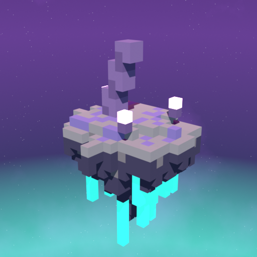</p>

<h1 align="center">Where Worlds Go to Fall</h1>

<p align="center"><i>The Nether gives power. The End gives reach.</i></p>

<p align="center">
An End expansion for <b>Minecraft: Java Edition 26.3</b> on <b>NeoForge</b>.<br>
<a href="https://github.com/Shengboj0324/Undertow/releases/latest"><b>Download</b></a> ·
<a href="https://github.com/Shengboj0324/Undertow/releases/download/v1.1.2/worldsfall_showcase_1.1.2.mp4"><b>Watch the 2-minute tour (1080p)</b></a> ·
<a href="#videos">All videos</a>
</p>


In vanilla Minecraft you visit the End twice: once to fight the dragon, once to grab an elytra. **Where Worlds Go to Fall**
turns it into a frontier you can live in. The void between the islands becomes a place of its own. A glowing tide of
nothingness rises and falls through it, creatures glide across it, and the wrecks of a lost civilization hang inside it.
Under the main island, a stairway opens into the dark and leads down to what that civilization became.

Nothing here makes you stronger in a fight. Instead, every reward lets you **go somewhere you couldn't go before**: across
a gap, under an island, into the tide, or finally out over the void to build there.

Everything on this page was captured in the game, with default settings and no shader packs.

---

## Contents

- [Getting started](#getting-started)
- [Your journey through the End](#your-journey-through-the-end)
- [The places](#the-places)
- [The living void](#the-living-void)
- [Creatures](#creatures)
- [Your Wyrm](#your-wyrm)
- [Gear](#gear)
- [The final boss: The Unmade](#the-final-boss-the-unmade)
- [Videos](#videos)
- [Settings and accessibility](#settings-and-accessibility)
- [Playing on a server](#playing-on-a-server)
- [For developers](#for-developers)

---

## Getting started

| You need | Version |
|---|---|
| Minecraft: Java Edition | **26.3** |
| Mod loader | **NeoForge 26.3.0.113** or newer 26.3 build |
| Java | **25** (the official launcher already includes it) |

1. Install NeoForge 26.3 for your launcher profile.
2. Download `worldsfall-1.1.2.jar` from the [latest release](https://github.com/Shengboj0324/Undertow/releases/latest).
3. Put it in the profile's `mods` folder and start the game.

**Your existing worlds work.** The dragon fight, End Cities, Shulkers, Endermen and elytra are untouched. New content
appears in parts of the End you haven't explored yet. If you already killed the dragon before installing, the island
opens up the next time you enter the End.

---

## Your journey through the End

There's no tutorial and no quest log. The world teaches you as you go, and each step opens up places the last one couldn't reach.

| | Step | What happens | What it opens up |
|---|---|---|---|
| 0 | **Kill the dragon** | The main island cracks open (*the Sundering*) and a stairway called *the Descent* appears | The Undercroft beneath the island |
| 1 | **Go down** | Walk the Descent into the Underside, where gravity is weak and crystals glow | Light, food, your first strange creatures |
| 2 | **Cross the gap** | Find a Void Skate roosting on a tiny islet and win its trust with Chorus Pods | The outer islands, *before* you own an elytra |
| 3 | **The near islands** | Graze on Chorus Reach, trade at Hoards, draw Stillwater from black lakes | Food, trading, glass and anchor technology |
| 4 | **The far islands** | Explore toppled towers, defeat their Wardens and **rebuild** their sealed rooms | Elytra upgrades, armor trims, the first Sigil |
| 5 | **Into the Drift** | Wait for low tide, then dive to the wrecks hanging in the void | Treasure, the second Sigil |
| 6 | **The three Sigils** | Spire, Tide and Under Sigils, from three different corners of the End | The Fracture Rift |
| 7 | **The Fracture** | A broken place below the bottom of the world | The Unmade |
| 8 | **Stability** | Win, and the void stops pulling | Gravity Anchors: build out over the void itself |

Alongside all of this, you can hatch the **Dragon Egg** into a Wyrm that grows up with you (see [Your Wyrm](#your-wyrm)).

---

## The places

The End is now four layers deep. **The Rim** is the island tops. **The Underside** hangs beneath large islands. **The Drift**
is the open void between and below them. **The Fracture** is a separate place, reached only at the end. The further
you travel from the center, the richer the islands get.

### Chorus Reach

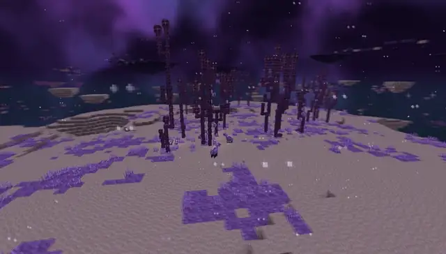

The End's pantry: soft lilac moss, tufts of grass and groves of chorus plants that glow at their tips. **Chorus
Grazers** wander in small herds.

- **Why go:** Chorus Pods (the food that tames Void Skates), Grazer meat, and frills for armor trims and saddles.
- **Tip:** pods regrow after you harvest them, so a grove is a farm you can come back to.

<br clear="right">

### Stillwater Basins

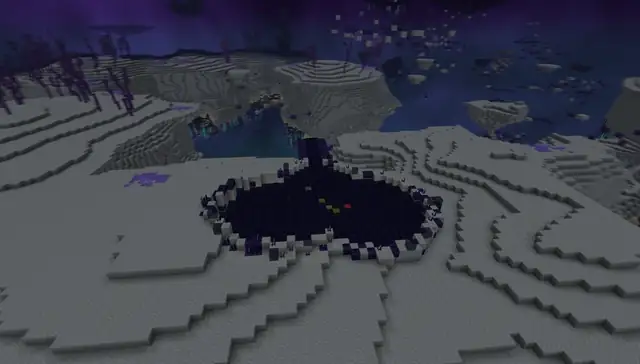

A heart-shaped ring of pale stone around a perfectly black lake that holds the stars upside down. A few Overworld blocks
float motionless on its surface, and at one edge a dark curtain of fluid slides off the island into the void.

- **Stillwater** is heavy and silent. Items float on it forever. Standing in it slowly drains your experience and muffles
  everything you hear.
- **Why go:** Stillwater (bucket it, bottle it, or keep it in a cauldron), Mirror Shards, and **Stillglass**, a dark glass
  that halves the sound passing through it.

<br clear="right">

### Fallen Spires

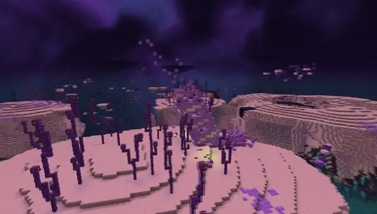

The towers of the civilization that tried to climb out of the End, now leaning, shattered or half-sunk into lakes. Each
one is guarded by a **Spire Warden** in cracked purpur plates, and **Echoes** hide in the rubble disguised as blocks.

- **Rebuild them:** a Warden drops a **Spire Key**. Put it in a *Keystone Socket* and the rubble lifts off the ground and
  flies back into place over about ten seconds, restoring a sealed room and opening its vault.
- **Why go:** elytra upgrade templates, the Spire armor trim, lore tablets and the Spire Sigil.

<br clear="right">

### The Hoard

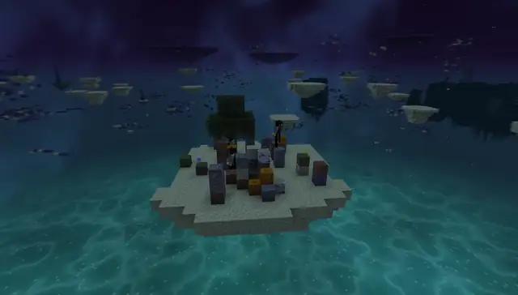

Small islands piled with grass, logs, ores and flowers that **Hoarder** Endermen have carried up from the Overworld for
generations. It's the one bright, colorful place in the End, and it is deliberately out of place.

- **Trade:** drop Overworld blocks into a Hoard Cache and the Hoarders give you something back: Chorus Pods, pearls,
  Stillglass, tablets, and sometimes a Gateway Compass.
- **Careful:** take things without trading and the whole Hoard turns on you for a while.

<br clear="right">

### The Underside

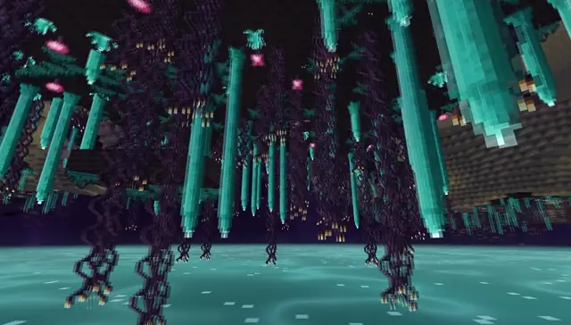

Under the large islands hangs an upside-down forest of roots and teal **Lumen** crystals. Gravity is weak down here, so
you jump higher and fall softly. Near the biggest crystal clusters you start floating upward.

- **Underside Lurkers** hang from single threads, nearly invisible until they drop.
- **Why go:** Lumen shards (light and armor trims), Glowbulbs (food that slows your fall), Voidroot fiber, and Root
  Hollows with the Undersong trim and the Under Sigil.

<br clear="right">

### The Drift

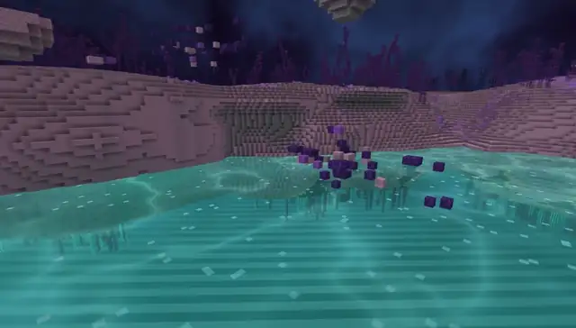

The open void between and below the islands. Void Skates circle in it, Tidewisps glow in it, and broken chunks of the old
world, the **Driftwrecks**, hang in it. At high tide they're drowned in glowing void; at low tide you can reach them.

- **Why go:** the richest loot in the End, the Tide Sigil, and the Drift armor trim.
- **Tip:** carry a Void Anchor. If you fall, your things will be waiting for you.

<br clear="right">

---

## The living void

### Void Tides

A glowing teal sheet of void stretches across the whole End and rises and falls on a timer. It stays low (Y 0) for about
ten minutes, rises over three minutes, stays high (Y 36) for ten minutes, then falls again. A faint dashed line lingers
where the tide just was, so you can tell which way it's moving.

- **Below the tide, the void eats you.** You take *Void Erosion* damage that grows the longer you stay and ignores armor.
- **You get warnings.** Two minutes before it rises, Tidewisps gather and pulse and a low hum starts. When it rises, the
  edges of the screen glow briefly.
- **You can measure it.** A Tide Gauge block gives a redstone signal, and holding a Gateway Compass or Void Lens shows the
  phase and time left under your hotbar.

### The Sundering

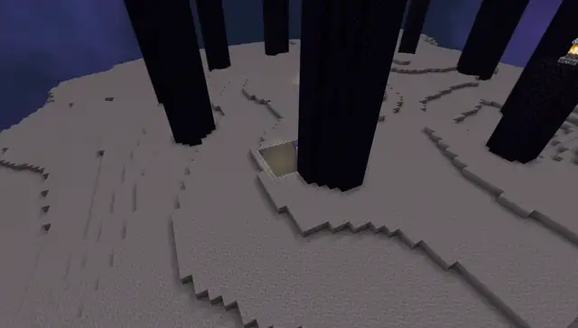

The first time the dragon dies in a world, the main island breaks. Magenta cracks race across the ground, and a shaft
opens about 40 blocks from the exit portal: **the Descent**. A spiral stairway leads down to the **Undercroft**,
a hall of dark stone lit by hanging crystals, and to the Rift that eventually takes you to the final boss.

It **never touches a block you placed**. If you've built where the shaft would open, it moves somewhere else.

<br clear="right">

### Gravity

- **Light zones** (the whole Underside): you fall slower, jump higher and take much less fall damage.
- **Gravity wells** (around big crystal clusters): you float upward when you're not standing on something.
- **Stable fields** (around a Gravity Anchor you place after the final boss): no Void Erosion inside, a slow, safe fall
  out of the bottom, and blocks you can build in midair.

The camera never flips. A *Reduced floatiness* setting softens all of this if it makes you uncomfortable.

---

## Creatures

<p align="center">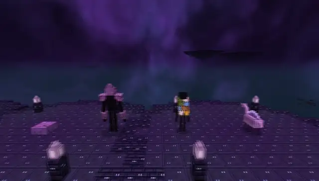</p>

### Void Skate: your first wings

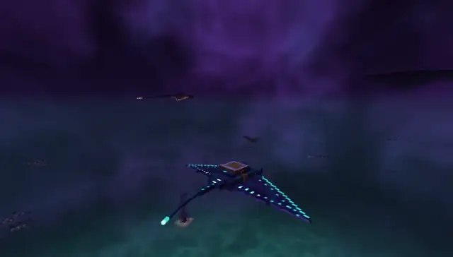

A manta-like glider with a five-block wingspan and glowing teal spots. Skates are shy and never attack.

**Taming**
1. Hold **Chorus Pods** near a Skate resting on a roost or an island edge. It will come closer.
2. Feed it pods. It needs five "trust" points, and each pod has a chance to add one. Trust slowly fades if you stop
   feeding, and resets if the Skate gets hurt.
3. When it chimes and gives off a ring of teal sparks, it's yours. Put a **Skate Harness** on it to ride.

<br clear="right">

**Riding**

| Control | What it does |
|---|---|
| Forward | Glide at cruising speed |
| Mouse | Steer in wide, banking turns |
| Jump (hold) | Climb (uses stamina, shown as a teal arc beside the crosshair) |
| Sneak (hold) | Dive and pick up speed |
| Sneak at an island edge | Land and perch, so you can get off safely |
| Nothing | Glide slowly down |

A Skate won't fly into the tide: it pulls up on its own. Two tamed Skates fed Glowbulbs will have a baby.

### Everyone else

| Creature | Where | What to know |
|---|---|---|
| **Chorus Grazer** | Chorus Reach | Gentle herd animal; food, and frills for trims and harnesses |
| **Underside Lurker** | The Underside | Hangs invisibly from a thread, then drops; its lens makes the Void Lens |
| **Hoarder** | Hoards | Enderman cousin in a patchwork cloak who trades Overworld blocks |
| **Spire Warden** | Fallen Spires | Tall, armored, slow; always drops a Spire Key |
| **Echo** | Spires and ruins | Disguises itself as a block. The tell is a faint hum and shading that's slightly off |
| **Wild Shulker** | Exposed ridges | Colonies that molt; a renewable source of shells |
| **Tidewisp** | The Drift | Little lights that gather before the tide rises; you can catch one in a bottle |
| **Shardling** | The Fracture | Splinters of the final boss |

---

## Your Wyrm

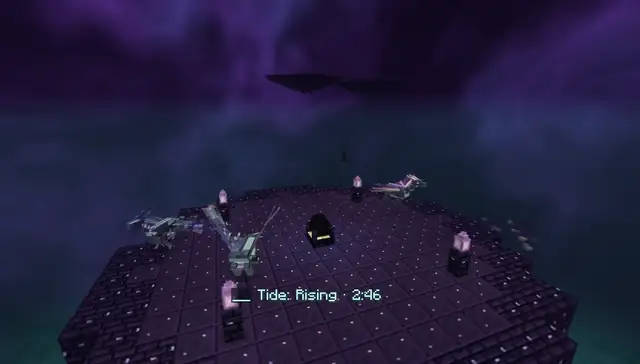

The Dragon Egg finally does something: it hatches.

**The ritual**
1. Build an **Egg Cradle** and place the egg on it. The four posts light up one by one.
2. Feed it **Glow Glands**, one at most every five minutes, eight in all. A crack of pink light appears with each one.
3. Keep it company. Someone has to stay near the cradle while it hums and glows brighter. In the End this takes half as long.
4. It hatches in a burst of light and bonds to whoever fed it the most.

<br clear="right">

**Growing up**

| Stage | Size | What it does |
|---|---|---|
| **Hatchling** | Cat-sized | Follows you, glows, **rides on your shoulder** like a parrot, and chirps before the tide rises |
| **Fledgling** | Wolf-sized | When you sneak, points its head toward the nearest Driftwreck; dives to fetch items that fall off an island |
| **Drake** | Horse-sized | Fed Roasted Chorus Pods and fitted with a Skate Harness, it carries you on short flights and shields you from Void Erosion |

If your Wyrm dies, it leaves a *Slumbering Egg* behind, so you don't lose it for good.

---

## Gear

<p align="center">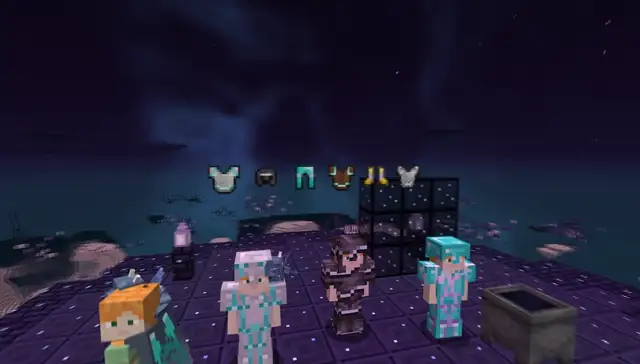</p>

Every piece of gear lets you **reach** somewhere new. None of it hits harder than Netherite.

| Item | What it does | How you get it |
|---|---|---|
| **Void Anchor** | If you die in the void or below the tide, your items are sealed in a glowing capsule that floats above the tide, waiting for you | Crafted from Stillglass, an ender eye, iron and a Glow Gland (a cheaper *Cracked* version saves half) |
| **Rift Tether** | A pearl-powered grappling hook: fire, reel in, swing, let go | Crafted from Voidroot fiber, an ender pearl and iron |
| **Gateway Compass** | Points to the nearest End Gateway you haven't used. Use it on one to remember it, and it shows the tide while you hold it | A compass ringed with Echo Dust; sometimes from Hoards |
| **Shulker Satchel** | A carried 9-slot bag (upgradable to 18) that doesn't use your chest slot | A Shulker shell, a chest and leather |
| **Void Lens** | An upgraded spyglass. Through it, Echoes and hidden Lurkers glow teal, Driftwrecks within 128 blocks are boxed with their distance, and the tide's height is marked | Spyglass + Lurker Lens + Echo Dust at a smithing table |
| **Elytra upgrades** | **Gale**: double-tap jump in flight for a boost. **Still**: hold sneak to brake. **Hover**: hold sneak to hang in the air for a moment. Each one changes how your wings look | Templates from Fallen Spire vaults |
| **Armor trims** | Three patterns (**Spire**, **Drift**, **Undersong**) and three colors (**Lumen** teal, **Still** black with a silver edge, **Frill** lavender) | Templates from Spires, Driftwrecks and Root Hollows |
| **Gravity Anchor** | Creates a stable field where you can build in midair over the void | After defeating The Unmade |

<p align="center">
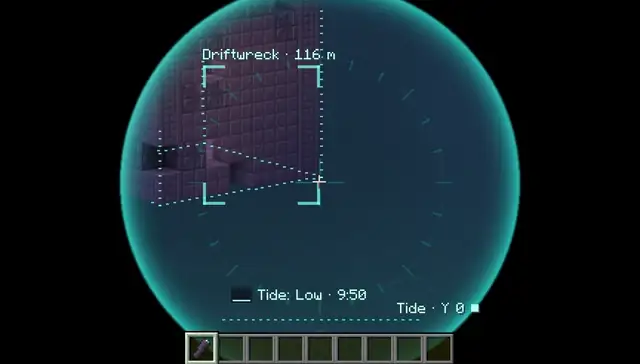
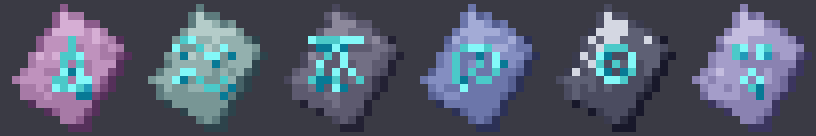
</p>

**Food:** Roasted Chorus Pods, Grazer steak, Drift Stew, Glowbulbs (which slow your fall), and Stillwater Tea, which
cures Levitation and Void Erosion.

<p align="center">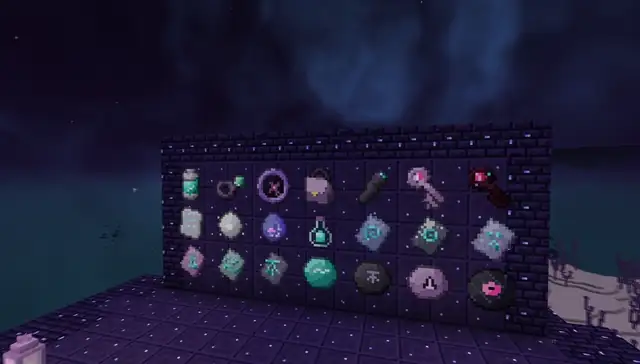</p>

---

## The final boss: The Unmade

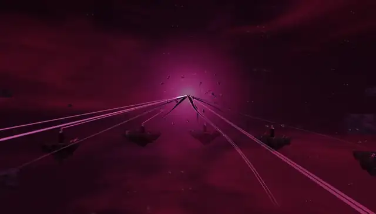

Collect the three Sigils, set them in the Rift Frame in the Undercroft, and step through into **the Fracture**: a ring of
broken islands orbiting a blinding core wrapped in black shards. The Unmade doesn't so much want to kill you as to pull
the ground out from under you.

1. **The Shell.** The core is shielded. Break the crystals on the pylons around the ring to crack the shields open, while
   dodging shard volleys, sweeping tendrils and patches of reversed gravity.
2. **The Unbinding.** The arena drifts apart. Islands slide outward and crumble. Shardlings swarm, and a pulse of void
   rolls across the ground, so jump to dodge it.
3. **Unmade.** Only debris is left, and the core pulls everything inward. Keep moving out and keep hitting.

Win, and everything stops. The debris settles into a single calm island under your feet. You get the **Heart of
Stillness** (your first Gravity Anchor), a music disc, and the ability to build out over the void. Its health scales with the number of players.

<br clear="right">

---

## Videos

Every clip was recorded in the game by an automated camera tour. Click a scene to watch it in full HD.

| | | |
|---|---|---|
| [▶ **Full tour** (2:17)](https://github.com/Shengboj0324/Undertow/releases/download/v1.1.2/worldsfall_showcase_1.1.2.mp4) | [▶ Chorus Reach](https://github.com/Shengboj0324/Undertow/releases/download/v1.1.2/clip_chorus_reach.mp4) | [▶ Stillwater Basins](https://github.com/Shengboj0324/Undertow/releases/download/v1.1.2/clip_stillwater_basins.mp4) |
| [▶ Fallen Spires](https://github.com/Shengboj0324/Undertow/releases/download/v1.1.2/clip_fallen_spires.mp4) | [▶ The Hoard](https://github.com/Shengboj0324/Undertow/releases/download/v1.1.2/clip_the_hoard.mp4) | [▶ The Underside](https://github.com/Shengboj0324/Undertow/releases/download/v1.1.2/clip_the_underside.mp4) |
| [▶ The Drift at high tide](https://github.com/Shengboj0324/Undertow/releases/download/v1.1.2/clip_the_drift.mp4) | [▶ Void Skate](https://github.com/Shengboj0324/Undertow/releases/download/v1.1.2/clip_void_skate.mp4) | [▶ Trims, wings and a shoulder Wyrm](https://github.com/Shengboj0324/Undertow/releases/download/v1.1.2/clip_wardrobe.mp4) |
| [▶ Creatures](https://github.com/Shengboj0324/Undertow/releases/download/v1.1.2/clip_creatures.mp4) | [▶ Through the Void Lens](https://github.com/Shengboj0324/Undertow/releases/download/v1.1.2/clip_void_lens.mp4) | [▶ Egg Cradle and Wyrm](https://github.com/Shengboj0324/Undertow/releases/download/v1.1.2/clip_egg_cradle_wyrm.mp4) |
| [▶ Gravity Anchor](https://github.com/Shengboj0324/Undertow/releases/download/v1.1.2/clip_gravity_anchor.mp4) | [▶ The items](https://github.com/Shengboj0324/Undertow/releases/download/v1.1.2/clip_items.mp4) | [▶ The Unmade](https://github.com/Shengboj0324/Undertow/releases/download/v1.1.2/clip_the_unmade.mp4) |
| [▶ The Sundering](https://github.com/Shengboj0324/Undertow/releases/download/v1.1.2/clip_sundering.mp4) | | |

<p align="center">
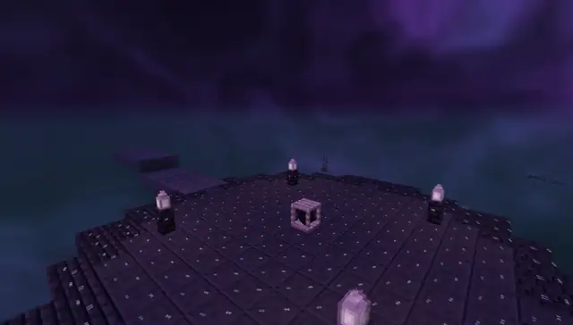
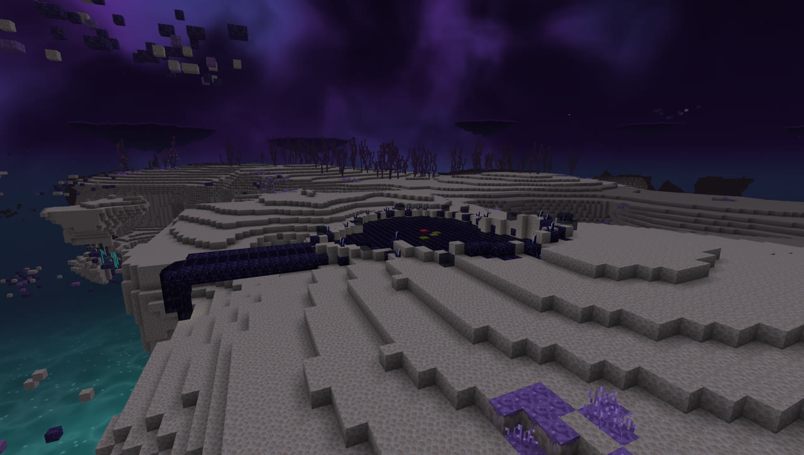
</p>

---

## Settings and accessibility

Open **Mods → Where Worlds Go to Fall → Config** in game.

- **Custom sky:** turn the new layered End sky (nebulae, three star layers, distant islands, the tide's glow) on or off.
- **Tide indicator:** show the tide's phase and countdown always, only while you hold a tide item, or never.
- **Screen effects:** the glow at the screen edges when the tide rises, and the darkening under Stillwater.
- **Reduced flashing**, for the boss fight and the Sundering.
- **Reduced floatiness**, for low-gravity areas.
- **Stillwater sound muffling.**

Server owners can change the tide timing, gravity strength, how many creatures spawn, boss difficulty, and whether the
Sundering happens at all.

---

## Playing on a server

Install the mod on **both** the server and every player's game. The server controls the tides, the Sundering and the
boss, and everyone sees the same thing. Each player gets their own vault loot and their own boss rewards, and boss
health grows with the number of players.

This is tested on a real NeoForge server with two players. One player sees everything the other is wearing and doing:
trims, elytra upgrades, a Wyrm on the shoulder, the tide.

<p align="center">
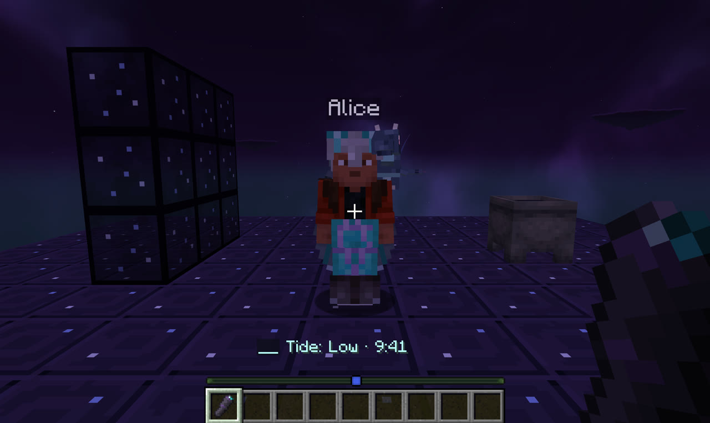

</p>

**Operator commands:** `/worldsfall tide get|set <low|rising|high|falling>|pause|resume` ·
`/worldsfall sundering status|trigger` · `/worldsfall gravity debug` · `/worldsfall wyrm stage <player> <stage>` ·
`/worldsfall wyrm shoulder <player>` · `/worldsfall boss reset` · `/worldsfall locate <structure>`

---

## For developers

<details>
<summary>Building, tests, the asset pipeline and the automated captures</summary>

The full specification is in [`worldsfall-design-document.md`](worldsfall-design-document.md), and the design board
summary is in [`worldsfall-whiteboard-companion.md`](worldsfall-whiteboard-companion.md). Where the implementation differs
from the document, the reasons are in [`docs/DECISIONS.md`](docs/DECISIONS.md). Release notes are in
[`CHANGELOG.md`](CHANGELOG.md).

### Build

```bash
export JAVA_HOME=/path/to/jdk-25
./gradlew build --no-configuration-cache
```

The jar is written to `build/libs/`. Compilation runs with `-Xlint:all -Werror`.

### Tests

```bash
./gradlew test --no-configuration-cache                 # JUnit (tide maths, region rules)
./gradlew runGameTestServer --no-configuration-cache    # 23 in-world GameTests, exits non-zero on failure
```

**Multiplayer:** `python3 tools/mptest/mp_test.py <server dir> <jar>` starts a production NeoForge server (installed
with the official installer, EULA accepted) running the jar. It joins that server with two dev clients (`runMpAlice`,
`runMpBob`) and stages trimmed armor, an upgraded elytra and a shoulder Wyrm on Alice. It then checks from Bob's client
that the mod channel, tide, trims, elytra upgrade and shoulder Wyrm all synced, and fails on any error in any log.

### Asset pipeline

All art is produced by scripts so it can be rebuilt and reviewed.

| What | Command |
|---|---|
| Block, item, particle, GUI and environment textures (Blender bakes) | `tools/blender/build_textures.sh` |
| Entity models, skins and previews (Blender → JSON) | `python3 tools/blender/models/build_all.py` |
| Mod icon | `Blender -b --python tools/blender/icon/build_icon.py -- src/main/resources/worldsfall_icon.png` |
| Sounds and music | `python3 tools/audio/synth.py` (spec in `tools/audio/sound_spec.py`) |
| Blockstates, models, loot, recipes, tags, worldgen, lang, trim icons | `tools/gen/gen_all.sh` |
| Armor trim patterns and material palettes | `python3 tools/gen/gen_trims.py <extracted 26.3 client assets/minecraft/textures>` |
| Smithing template icons | `python3 tools/gen/gen_templates.py` |
| Void Lens scope overlay | `python3 tools/gen/gen_lens_scope.py` |

### In-game capture

`./gradlew runShowcase` starts a dev client that creates a fresh world, visits every scene above, takes stills and orbit
frame sequences into `build/showcase/`, and exits. Use `-Pshowcase.scenes=a,b` for a subset and `-Pshowcase.video=false`
for stills only. `tools/showcase/make_video.sh` assembles the videos, and `tools/showcase/make_previews.py` makes the
looping previews on this page.

</details>

## License

MIT. See [`LICENSE`](LICENSE).
