<p align="center"></p>

# Where Worlds Go to Fall

*The Nether gives power. The End gives reach.*

An End expansion for **Minecraft: Java Edition 26.3** on **NeoForge**. The void stops being a death plane and becomes the terrain:
Void Tides rise and fall over the outer islands, Void Skates carry you across gaps before you ever own an elytra, toppled
End Cities can be rebuilt block by block, the Dragon Egg hatches into a Wyrm that grows up with you, and below the bottom of
the world waits **The Unmade**.

The full specification lives in [`worldsfall-design-document.md`](worldsfall-design-document.md); the design board is summarised
in [`worldsfall-whiteboard-companion.md`](worldsfall-whiteboard-companion.md). Implementation choices that differ from the
document are recorded in [`docs/DECISIONS.md`](docs/DECISIONS.md).

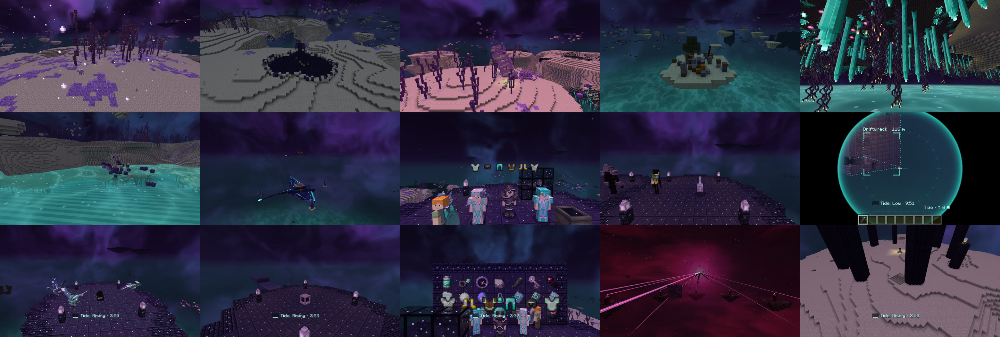

## Requirements

| | |
|---|---|
| Minecraft | Java Edition **26.3** |
| Loader | **NeoForge 26.3.0.113** or newer 26.3.x |
| Java | **25** (bundled with the official launcher for 26.x) |
| Side | Required on both client and server |

## Installing

1. Install NeoForge 26.3 for your launcher profile.
2. Download `worldsfall-1.1.2.jar` from the [latest release](https://github.com/Shengboj0324/Undertow/releases/latest).
3. Drop it into the profile's `mods/` folder and start the game.

The mod adds its biomes to the vanilla End biome source and keeps the vanilla dragon fight, End Cities, Shulkers and
Endermen intact. Existing worlds are supported: new content generates in chunks that have not been generated yet.

## What's in it

**World** — four layers of void (the Rim, the Underside, the Drift, the Fracture); six new End biomes (Chorus Reach,
Stillwater Basins, Fallen Spires, The Hoard, The Underside, The Drift); a cyclic **Void Tide** with a glowing plane, ghost
line and Void Erosion; low-gravity zones and gravity wells; **the Sundering** that opens the main island after the dragon dies;
the **Undercroft**, Driftwrecks, Hoards, Root Hollows, Skate Roosts and Echo Shrines; and the **Fracture** dimension.

**Creatures** — Void Skate (tame, saddle and ride), Chorus Grazer, Underside Lurker, Hoarder, Spire Warden, Echo, Wild
Shulker, Tidewisp, Shardling, the Wyrm companion (three growth stages) and the boss **The Unmade** with three phases.

**Reach, not power** — Void Anchor (void-death item capsule), Rift Tether (pearl grappling hook), Gateway Compass,
Shulker Satchel, Void Lens (reveals Echoes, Lurkers, Driftwrecks and the tide height), Gale/Still/Hover elytra upgrades
with their own wing looks, Gravity Anchor and Anchor Frames, Spire Keys and
**Reassembly** of ruined spire rooms, Echo Tablet lore, three armor trim patterns and three trim materials, Stillwater (a heavy mirror-black fluid you can
bottle and keep in a cauldron), sound-muffling Stillglass, and food. A Hatchling Wyrm rides on your shoulder.

**Presentation** — a custom layered End sky shader (biome-tinted nebula, three star layers, distant islands, tide glow), a
Fracture sky, the tide plane shader, Blender-authored entity models and textures with emissive layers, 15 particle types,
214 synthesized sounds and music layers, HUD for skate stamina and tides, and accessibility options (reduced flashing,
reduced floatiness, tide indicator).

## Gallery

All captured in-game by the automated showcase run (default settings, no shader packs).

| | |
|---|---|
| 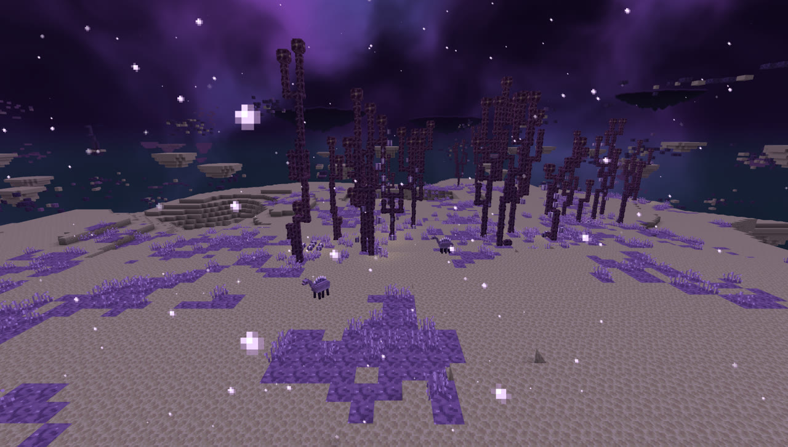 Chorus Reach | 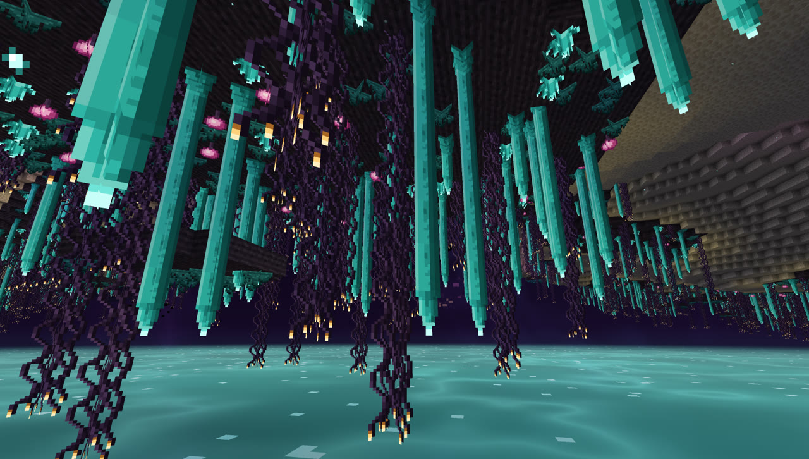 The Underside |
| 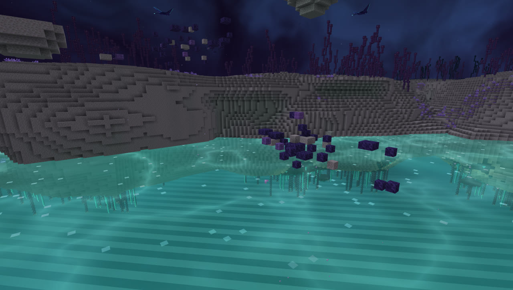 The Drift at high tide | 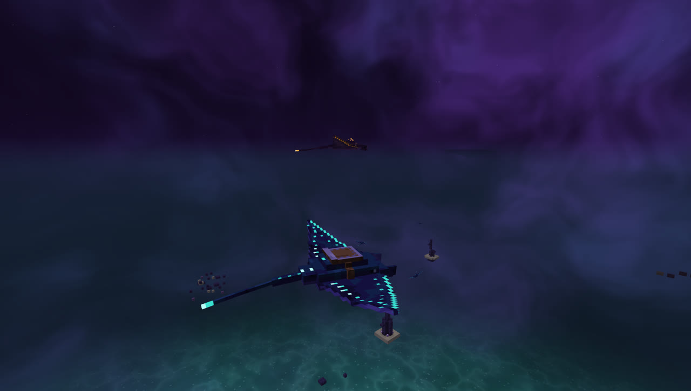 Void Skate |
| 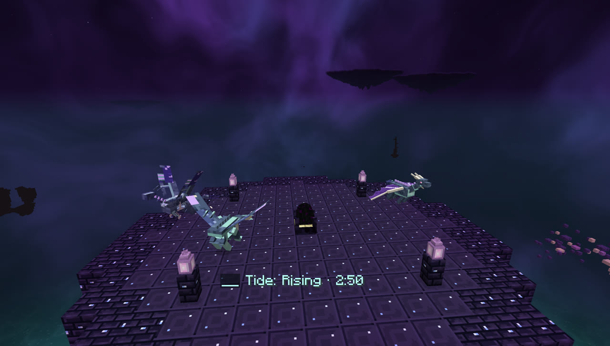 Egg Cradle and Wyrm stages | 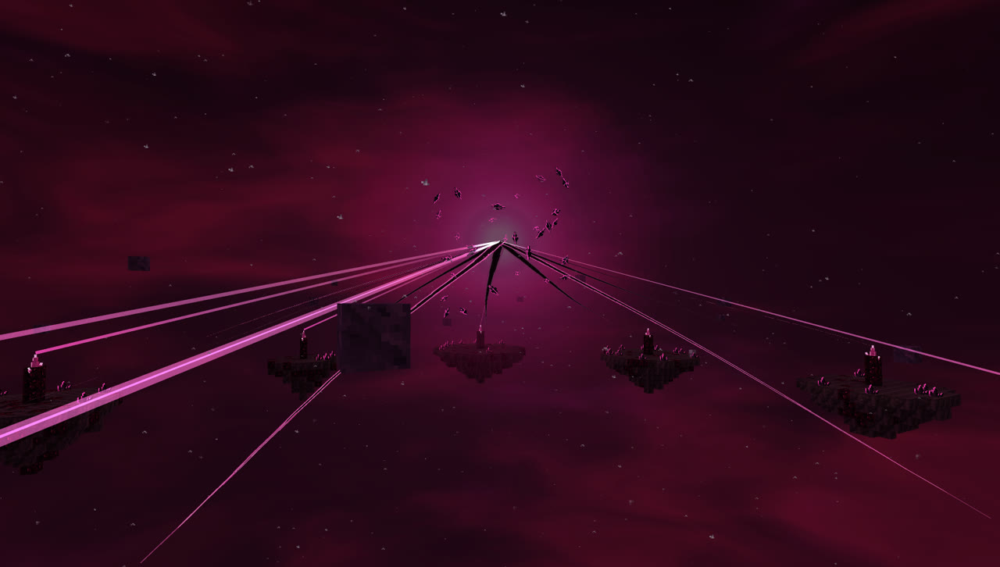 The Unmade |
| 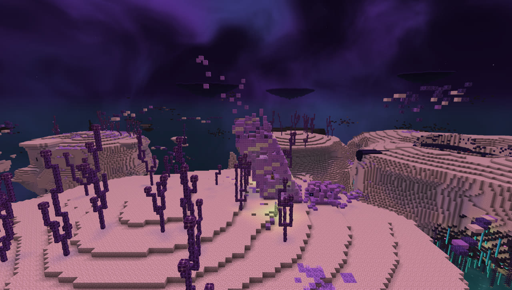 Fallen Spires | 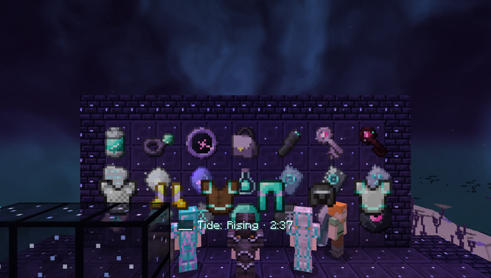 Reach, not power |
| 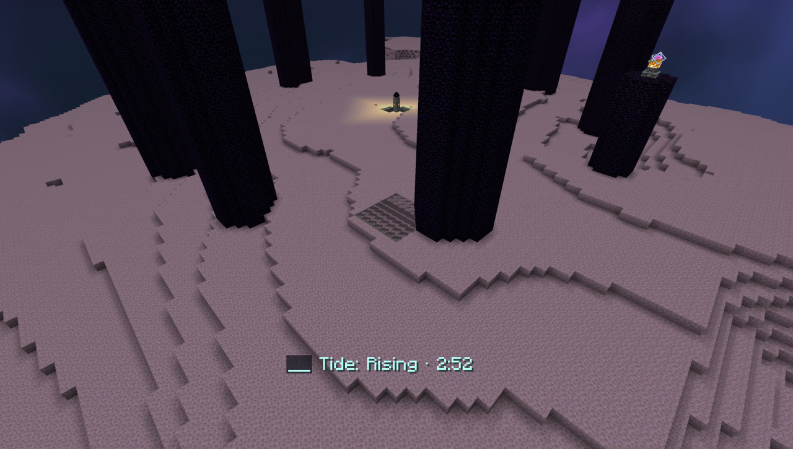 The Sundering opens the Descent | 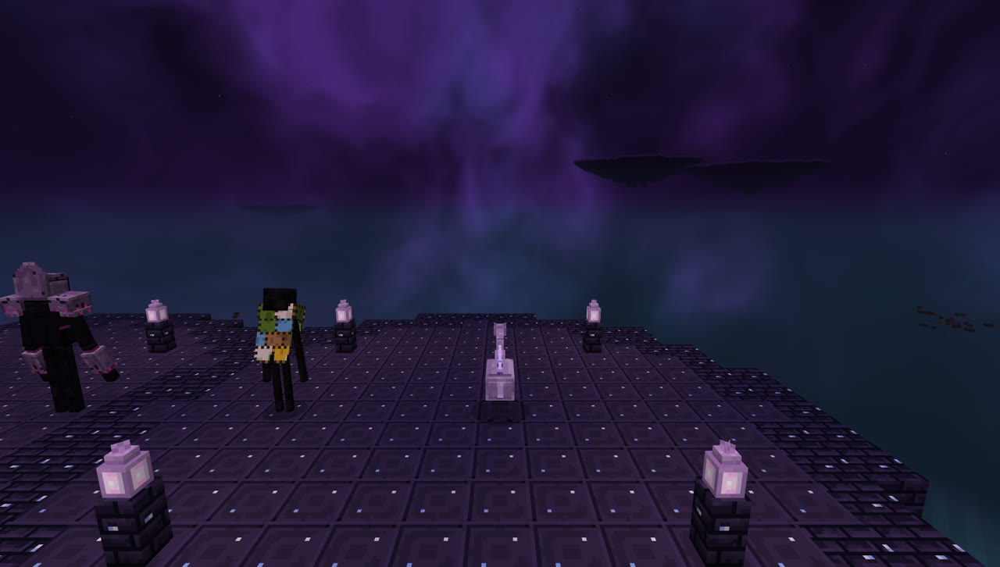 End castes |
| 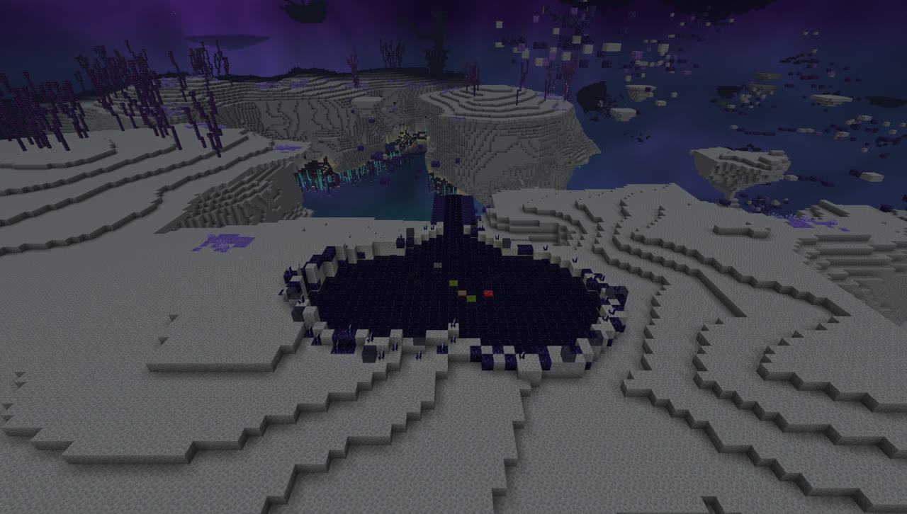 A Stillwater Basin and its Stillfall |  A Driftwreck through the Void Lens |
| 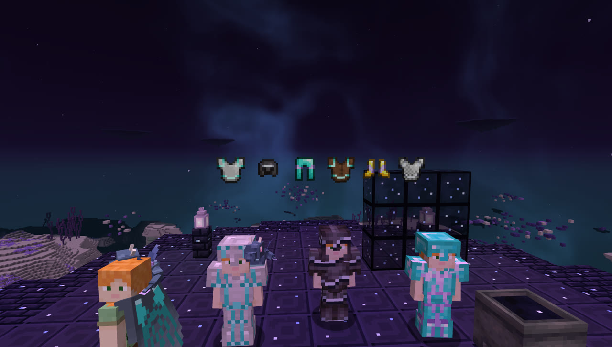 Spire, Drift and Undersong trims; Gale wings; a Wyrm on the shoulder |  The Stillfall leaves the island |

## Commands (operators)

`/worldsfall tide get|set <low|rising|high|falling>|pause|resume` · `/worldsfall sundering status|trigger` ·
`/worldsfall gravity debug` · `/worldsfall wyrm stage <player> <stage>` · `/worldsfall wyrm shoulder <player>` · `/worldsfall boss reset` ·
`/worldsfall locate <structure>`

## Configuration

`config/worldsfall-synced.toml` (server-authoritative, synced to clients) covers tides, gravity, erosion, spawn budgets, the boss and the Sundering;
`worldsfall-client.toml` covers the custom sky, HUD and accessibility. All keys from §21 of the design document are present.

## Building from source

```bash
export JAVA_HOME=/path/to/jdk-25
./gradlew build --no-configuration-cache
```

The jar is written to `build/libs/`. Compilation runs with `-Xlint:all -Werror`.

### Tests

```bash
./gradlew test --no-configuration-cache                 # JUnit (tide maths, region rules)
./gradlew runGameTestServer --no-configuration-cache    # 23 in-world GameTests, exits non-zero on failure
```

### Multiplayer test

`tools/mptest/mp_test.py <server dir> <jar>` starts a production NeoForge server (installed with the official installer,
EULA accepted) running the built jar, joins it with two dev clients (`runMpAlice`, `runMpBob`), stages trimmed armor, an
upgraded elytra and a shoulder Wyrm on Alice in the End, and checks from Bob's client that everything synced (mod channel,
tide state, trims, elytra upgrade and wing look, shoulder Wyrm). It takes screenshots from both clients and fails on any
error or exception in the server or client logs.

| | |
|---|---|
|  Alice as Bob's client sees her on the production server: trims and a shoulder Wyrm | 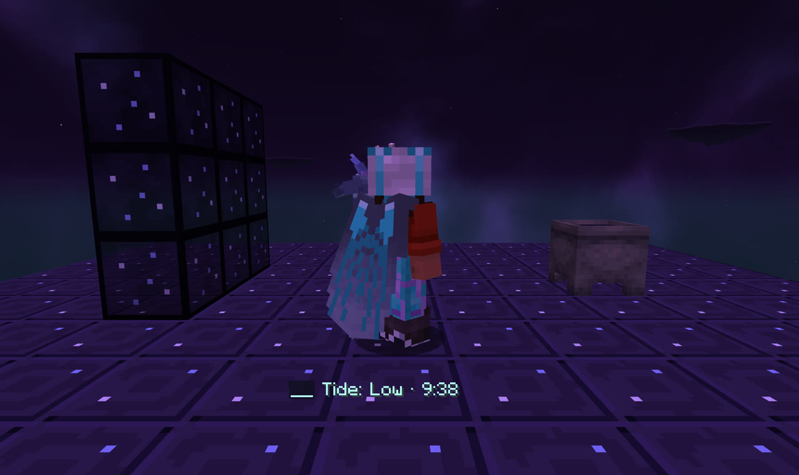 Her Gale elytra wings from behind |

### Asset pipeline

All art is produced by scripts so it can be rebuilt and reviewed:

| What | Command |
|---|---|
| Block/item/particle/GUI/environment textures (Blender bakes) | `tools/blender/build_textures.sh` |
| Entity models, skins and previews (Blender → JSON) | `python3 tools/blender/models/build_all.py` |
| Mod icon | `Blender -b --python tools/blender/icon/build_icon.py -- src/main/resources/worldsfall_icon.png` |
| Sounds and music | `python3 tools/audio/synth.py` (spec in `tools/audio/sound_spec.py`) |
| Blockstates, models, loot, recipes, tags, worldgen, lang | `tools/gen/gen_all.sh` |
| Armor trim patterns and material palettes | `python3 tools/gen/gen_trims.py <extracted 26.3 client assets/minecraft/textures>` |
| Void Lens scope overlay | `python3 tools/gen/gen_lens_scope.py` |
| Smithing template icons (trims and elytra upgrades) | `python3 tools/gen/gen_templates.py` |

### In-game visual capture

`./gradlew runShowcase` starts a dev client that creates a fresh world, visits every "picture" scene from §18.10
(biomes, structures, creatures, the Wyrm ritual, the Gravity Anchor, the items, The Unmade and the Sundering), takes stills
and orbit frame sequences into `build/showcase/`, then exits. `tools/showcase/make_video.sh` assembles the video.
Use `-Pshowcase.scenes=a,b` to capture a subset and `-Pshowcase.video=false` for stills only.

## License

MIT — see [`LICENSE`](LICENSE).
