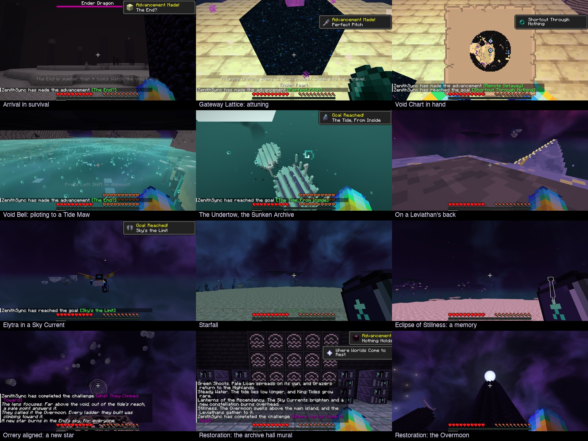

# Real-client playtest (2.0.1)

Worldsfall 2.0 was played in the **real Minecraft client**, started from the official launcher, with NeoForge
26.3.0.113 installed by its own installer and the release jar in the profile's `mods` folder. It was played by a
built-in driver ([`Playtest.java`](../src/main/java/dev/worldsfall/client/showcase/Playtest.java)), not a spectator
camera. A fresh **survival** world was used. The driver presses the real use, movement, jump and sneak keys, clicks the
Lattice screen, pilots the Void Bell and stands on a Leviathan. Every scenario ends in checks on both client and server.
Its frames are the clips on the [v2.0.1 release](https://github.com/Shengboj0324/Undertow/releases/tag/v2.0.1).



## What it found (all fixed in 2.0.1)

| Found | Symptom in the real game | Cause | Fix |
|---|---|---|---|
| Server crash | Diving a Tide Maw crashed the server (`ConcurrentModificationException` in `TideMaws.tick`) | The maw loop walked `end.players()` while the dive moved the player out of the End | Gather the maws first, iterate a copy; one pull per maw |
| Void Bell crawled in the Undertow | 7 blocks in 13 s; a minute to climb out | The Undertow's drift nudged every living thing; for a player-steered bell the nudge was sent to the pilot's client and reset its speed every 5 ticks | No nudge for vehicles a player steers (climb 1202 → 471 ticks) |
| Nothing usable aboard the bell | Right-clicking a Codex did nothing | The crosshair rests on the bell's own hull; the click "boarded" it again | Riders' clicks pass to the held item (a Fragment still charges) |
| Last blank chart vanished | Using your last Empty Void Chart left an empty hand | In 26.3 `ItemStack.use` reports the emptied stack as the result, overwriting the chart | Return the chart as `heldItemTransformedTo` |
| Falling through a Leviathan | Riders sank in and fell 150 blocks when it eased its dive | A player already overlapping an entity box passes through it | Riders are held on the back each tick |
| Leviathan drawn too high | First person on its back showed only purple hide | The model offset had the wrong sign (applied after the renderer flips the pose): body at 3.6–10.6 over a 0–5 hitbox | Offset fixed; back and garden on the hitbox top |
| Bell hull blocked the view | A third of the pilot's first-person view was the hull | The bell rendered for its own rider | Not drawn for its riders in first person |
| Currents a moment late | A glider launched at once could miss the current | The current list was sent on a 20-tick schedule | Sent the tick a player arrives or changes region |

Not bugs, but worth knowing: with **Night Vision** during the dragon fight the boss fog turns bright pink. That is
vanilla (Night Vision scales fog colour to full brightness), not the mod.

## Results: full run, 12 scenarios, 62 checks, 0 failed

| Scenario | Check | Result | Detail |
|---|---|---|---|
| p_arrival | chunks drawn | PASS | after 0 ticks;  |
| p_arrival | tide synced to client | PASS | ok phase low |
| p_arrival | walked forward with W | PASS | ok moved 14.6 blocks |
| p_lattice | arrived in the_end | PASS | after 0 ticks;  |
| p_lattice | chunks drawn | PASS | after 0 ticks;  |
| p_lattice | Tuning Fork attunes gateway B | PASS | ok Drifting Stair |
| p_lattice | Tuning Fork attunes gateway A | PASS | ok lattice has 2 nodes |
| p_lattice | sneaking into an attuned gateway opens the Lattice | PASS | after 34 ticks; screen=LatticeScreen |
| p_lattice | vanilla gateway did not fire | PASS | ok still at A |
| p_lattice | picking gateway B jumps there | PASS | after 0 ticks; at BlockPos{x=1598, y=101, z=1660} |
| p_lattice | a jump costs one pearl in survival | PASS | ok 2 left |
| p_chart | using the blank chart draws a Void Chart | PASS | after 0 ticks; hand=1 worldsfall:void_chart |
| p_chart | the chart's map data reaches the client | PASS | after 0 ticks;  |
| p_chart | chart has decorations | PASS | ok 3 decorations, scale 2 |
| p_bell_dive | arrived in the_end | PASS | after 0 ticks;  |
| p_bell_dive | chunks drawn | PASS | after 0 ticks;  |
| p_bell_dive | maws are open at High Tide | PASS | ok tide 36.0 |
| p_bell_dive | the Void Bell item sets a bell down | PASS | ok bell at BlockPos{x=3288, y=39, z=2658} |
| p_bell_dive | a Stillness Fragment charges it | PASS | ok charge 10 min |
| p_bell_dive | right-click boards the bell | PASS | after 0 ticks;  |
| p_bell_dive | piloted into the open maw, the bell sinks into the Undertow | PASS | after 188 ticks; at BlockPos{x=3265, y=199, z=2656} |
| p_bell_dive | still aboard after the descent | PASS | after 6 ticks;  |
| p_bell_dive | Undertow chunks drawn | PASS | after 0 ticks;  |
| p_undertow | pilot toward the Sunken Archive | PASS | after 194 ticks; at BlockPos{x=3282, y=178, z=2663} |
| p_undertow | the Undertow is alive (creatures near) | PASS | ok 18 worldsfall creatures within 96 |
| p_undertow | the Sunken Archive stands | PASS | ok 127 shelves |
| p_undertow | the Codex counts as read on the server | PASS | ok |
| p_undertow | reading a Codex shows its record | PASS | after 0 ticks; codex.worldsfall.2 |
| p_undertow | rising past the ceiling returns to the End | PASS | after 473 ticks; y=38.8 |
| p_undertow | still aboard on return | PASS | after 0 ticks;  |
| p_leviathan | arrived in the_end | PASS | after 0 ticks;  |
| p_leviathan | chunks drawn | PASS | after 0 ticks;  |
| p_leviathan | standing on its back after 13 s | PASS | ok |
| p_leviathan | carried along with it | PASS | ok carried 31.5 blocks |
| p_sky_current | arrived in the_end | PASS | after 0 ticks;  |
| p_sky_current | chunks drawn | PASS | after 0 ticks;  |
| p_sky_current | the client knows the nearby currents | PASS | after 0 ticks; 7 currents |
| p_sky_current | jump in the air opens the elytra | PASS | after 3 ticks;  |
| p_sky_current | the glider caught the current | PASS | ok top speed 24.0 m/s |
| p_starfall | arrived in the_end | PASS | after 0 ticks;  |
| p_starfall | chunks drawn | PASS | after 0 ticks;  |
| p_starfall | the event begins | PASS | ok |
| p_starfall | the client hears of it | PASS | after 0 ticks; client event 1 |
| p_starfall | a star is coming down | PASS | ok site BlockPos{x=1199, y=67, z=339} |
| p_starfall | shards landed | PASS | ok 8 placed |
| p_eclipse | arrived in the_end | PASS | after 0 ticks;  |
| p_eclipse | chunks drawn | PASS | after 0 ticks;  |
| p_eclipse | the event begins | PASS | ok |
| p_eclipse | the client hears of it | PASS | after 0 ticks; client event 3 |
| p_eclipse | the sky has stilled | PASS | ok site BlockPos{x=0, y=0, z=0} |
| p_eclipse | memories walk | PASS | ok 4 memories |
| p_orrery | arrived in the_end | PASS | after 0 ticks;  |
| p_orrery | chunks drawn | PASS | after 0 ticks;  |
| p_orrery_rings | Spire Key frees ring 0 | PASS | ok |
| p_orrery_rings | Spire Key frees ring 1 | PASS | ok |
| p_orrery_rings | Spire Key frees ring 2 | PASS | ok |
| p_orrery_rings | a new star burns in the sky | PASS | ok 1 star(s) |
| p_restoration | arrived in the_end | PASS | after 0 ticks;  |
| p_restoration | chunks drawn | PASS | after 0 ticks;  |
| p_restoration | the client knows the Restoration stage | PASS | ok stage 5 |
| p_restoration | the Overmoon hangs over the island | PASS | ok radius 0.1 |

Restoration re-run, after a real Sundering:

| Scenario | Check | Result | Detail |
|---|---|---|---|
| p_leviathan | chunks drawn | PASS | after 0 ticks;  |
| p_leviathan | standing on its back after 13 s | PASS | ok |
| p_leviathan | carried along with it | PASS | ok carried 31.6 blocks |
| p_restore_prep | arrived in the_end | PASS | after 0 ticks;  |
| p_restore_prep | chunks drawn | PASS | after 0 ticks;  |
| p_restore_prep | the Sundering opens the Undercroft | PASS | after 171 ticks; ok |
| p_restore_prep | the dragon is gone | PASS | ok |
| p_restore_prep | the archive hall is carved | PASS | after 1 ticks; ok |
| p_restoration | arrived in the_end | PASS | after 0 ticks;  |
| p_restoration | chunks drawn | PASS | after 0 ticks;  |
| p_restoration | the client knows the Restoration stage | PASS | ok stage 5 |
| p_restoration | the Overmoon hangs over the island | PASS | ok radius 0.1 |

The game log had no errors or exceptions in any of these runs. The 55 GameTests also pass.

## Worldsfall sounds heard during the full run

- ambient.chorus_reach.additions ×1
- ambient.chorus_reach.loop ×1
- ambient.fallen_spires.additions ×5
- ambient.fallen_spires.loop ×3
- ambient.the_drift.additions ×10
- ambient.the_drift.loop ×1
- ambient.undertow.additions ×7
- ambient.undertow.loop ×1
- ambient.zenith.loop ×2
- block.archive_shelf.read ×1
- block.orrery.align ×2
- block.orrery.turn ×3
- entity.echo.hum ×4
- entity.void_bell.creak ×3
- entity.void_bell.lamp ×1
- event.eclipse.begin ×1
- event.eclipse.end ×1
- event.lattice.jump ×2
- event.maw.open ×8
- event.maw.pull ×1
- event.reassembly.chord ×3
- event.reassembly.click ×59
- event.reassembly.fly ×31
- event.restoration.stage ×5
- event.sky_current.enter ×1
- event.starfall.streak ×1
- event.tide.rise ×1
- item.tuning_fork.strike ×2

Missing sound events: none

## Running it

Put `worldsfall-playtest.properties` in the profile's game folder:

```properties
out=/absolute/path/to/output
# optional: scenarios=p_lattice,p_bell_dive,p_undertow
```

(or pass `-Dworldsfall.playtest=<dir>`), launch, and leave it. It writes `report.md` and `frames/<NN_scenario>/`,
then quits. `bash tools/showcase/make_video.sh <dir>` turns the frames into clips.
